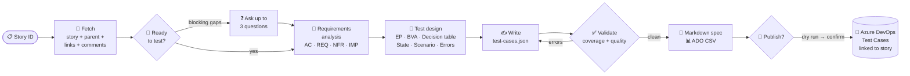

<div align="center">

# 🧪 ADO Test Case Generator

### From Azure DevOps user story to a reviewed, traceable manual test suite in minutes.

A **Claude Code skill** that reads a story from Azure DevOps, analyses it like a senior QA engineer,
designs test cases with formal ISTQB techniques, and publishes them back to Azure DevOps as linked **Test Case** work items.

[](https://github.com/akash0107/ado-test-case-generator/actions/workflows/ci.yml)


[](LICENSE)

[How it works](#-how-it-works) · [Quick start](#-quick-start) · [Sample output](#-sample-output) · [Quality gates](#-built-in-quality-gates) · [Roadmap](#-roadmap)

</div>

---

## ✨ Why this exists

Writing manual test cases by hand is slow and repetitive, and quality varies from person to person. Coverage gaps
usually show up in production, not in review. This project turns test design into a **repeatable, standards-driven
pipeline**:

```text
/manual-test-case-generator 1
```

| | Manual approach | With this skill |
|---|---|---|
| ⏱️ Time per story | 1–3 hours | **A few minutes, then human review** |
| 🎯 Coverage | Depends on the author | **Every requirement traced; gaps block export** |
| 📐 Technique | Mostly happy paths | **EP, BVA, decision tables, state transitions, error guessing** |
| ❓ Ambiguity | Discovered during testing | **Surfaced up front as open questions for the PO** |
| 🔗 Azure DevOps | Copy and paste, link by hand | **Created as Test Cases and linked with *Tests* links** |

## 🚀 Highlights

- **Reads the whole context:** description, acceptance criteria, parent feature, related items, discussion
  comments, and test cases already linked to the story, so it never duplicates existing coverage.
- **Thinks like a QA analyst:** breaks the story into atomic requirements (`AC` / `REQ` / `NFR` / `IMP`),
  checks whether the story is ready to test, and asks at most 3 targeted questions when something critical is ambiguous.
- **Uses formal test design:** applies Equivalence Partitioning, Boundary Value Analysis, Decision Tables,
  State Transition, Scenario and Error Guessing, chosen from the shape of each requirement.
- **Writes to industry standards:** follows rules based on **ISO/IEC/IEEE 29119-3** and **ISTQB**: observable expected
  results, concrete test data, independent cases, and a 1–4 risk-based priority model.
- **Enforces quality:** a validator rejects untraced requirements and vague expectations such as *"works as expected"*.
- **Produces three outputs:** a reviewable Markdown spec with a traceability matrix, an Azure Test Plans CSV, and direct
  publishing through the REST API.
- **Safe by default:** publishing is a dry run until you confirm, re-runs are idempotent, the token never leaves
  `.env`, and story text is treated as data, never as instructions.
- **No dependencies:** pure Python standard library, with retries, backoff and clear error messages.

## 🔍 How it works



## ⚡ Quick start

**Prerequisites:** [Claude Code](https://claude.com/claude-code), Python 3.9+, and an Azure DevOps project.

```bash
# 1. Clone
git clone https://github.com/akash0107/ado-test-case-generator.git
cd ado-test-case-generator

# 2. Configure Azure DevOps access (the token stays local; .env is git-ignored)
cp .env.example .env        # set ADO_ORG_URL, ADO_PROJECT, ADO_PAT

# 3. Verify the connection
python3 .claude/skills/manual-test-case-generator/scripts/fetch_story.py --check
# OK: connected to https://dev.azure.com/<org>, project '<project>' (wellFormed).
```

Then open Claude Code in the folder and run:

```text
/manual-test-case-generator 1234
/manual-test-case-generator 1234  Admin role only; mobile is out of scope.
```

Or just ask: *"Write test cases for story 1234."* When you're happy with the result: *"Publish them."*

<details>
<summary><b>🔑 Personal Access Token scopes</b></summary>

| You want to… | Scope |
|---|---|
| Read stories | Work Items → **Read** |
| Publish Test Case work items | Work Items → **Read & write** |
| Add cases to a Test Plan suite | Test Management → **Read & write** |

Full setup and troubleshooting: [`ado-setup.md`](.claude/skills/manual-test-case-generator/references/ado-setup.md)
</details>

## 📸 Sample output

A real run against a **Swag Labs login** story. The full result is in [`examples/swag-labs-login`](examples/swag-labs-login/1-test-cases.md).

> **15 test cases · 15/15 requirements covered · P1: 5 · P2: 6 · P3: 4**
> The story's ACs covered 7 of the 9 username × password combinations; the decision table found the other 2.

**Traceability matrix (excerpt)**

| Req ID | Requirement | Test cases | Status |
|---|---|---|---|
| AC-1 | Valid credentials → redirected to Products, URL contains `/inventory.html` | TC-1-001, TC-1-014, TC-1-015 | ✅ Covered |
| AC-8 | Locked user is rejected with a locked-user error | TC-1-004 | ✅ Covered |
| REQ-3 | Invalid or missing credentials never reach the inventory | TC-1-002 … TC-1-011 | ✅ Covered |
| IMP-1 | Username matched exactly (case, whitespace) | TC-1-013 | ✅ Covered |

**A generated test case**

> **TC-1-004 · Reject login for a locked-out user with valid credentials**
> `Security` · `P1` · *Equivalence Partitioning* · covers `AC-8`, `REQ-3`
>
> | # | Action | Expected result |
> |---|---|---|
> | 1 | Enter `locked_out_user` in **Username** and `secret_sauce` in **Password**. | |
> | 2 | Click **Login**. | The error *"Epic sadface: Sorry, this user has been locked out."* is displayed. |
> | 3 | Check the browser URL and page content. | The URL remains `https://www.saucedemo.com/` and the Products page is not displayed. |

**Open questions raised for the Product Owner (excerpt)**

1. AC-2/3/4/8 say *"appropriate error message"* without exact text. Is the current wording approved?
2. Should usernames be case-insensitive or have whitespace trimmed?
3. Is there a limit on failed login attempts?

## 🛡️ Built-in quality gates

Nothing is exported or published unless the validator passes:

| Gate | Rule |
|---|---|
| 🔗 Traceability | Every requirement maps to at least one test case. Untestable items need a written reason |
| 🎯 Observability | The final step always has an expected result; vague phrases (*"works correctly"*, *"as expected"*) are flagged |
| 🆔 Integrity | Unique IDs (`TC-<story>-NNN`) and titles; references must point to real requirements |
| 📏 Size | Cases with more than 15 steps are flagged for splitting |
| 🧾 Honesty | Inferred behaviour must be listed in `assumptions`; ambiguity goes in `open_questions` |

## 📦 Outputs

| File | For | Description |
|---|---|---|
| `<id>-test-cases.md` | Reviewers | Scope, traceability matrix, assumptions, open questions, full test cases |
| `<id>-ado-import.csv` | Azure Test Plans | *Test Plans → suite → ⋮ → Import test cases from CSV* |
| `test-cases.json` | Tools | Source data, validated against a [JSON schema](.claude/skills/manual-test-case-generator/references/test-case-schema.json) |
| Azure DevOps | Your team | Test Case work items with steps, priority, tags (`AI-Generated`, `Story-<id>`) and a *Tests* link to the story |

> 💡 **No Test Plans licence?** Creating test plans requires *Basic + Test Plans* access. Direct publishing creates
> Test Case work items through the Work Items API and **needs no test plan**.

## 🗂️ Project structure

```text
.
├── .claude/skills/manual-test-case-generator/   # The skill: self-contained and portable
│   ├── SKILL.md                                 # 9-step QA workflow Claude follows
│   ├── scripts/
│   │   ├── ado_client.py                        # Zero-dependency Azure DevOps REST client
│   │   ├── fetch_story.py                       # Story → normalized JSON / Markdown
│   │   ├── testcase_schema.py                   # Validation and coverage rules
│   │   ├── export_test_cases.py                 # JSON → Markdown spec and ADO CSV
│   │   └── publish_test_cases.py                # JSON → Test Case work items (dry run by default)
│   ├── references/                              # Standards Claude reads when it needs them
│   │   ├── test-case-standards.md               #   ISO 29119 / ISTQB writing rules and review checklist
│   │   ├── test-design-techniques.md            #   When and how to apply each technique
│   │   ├── test-case-schema.json                #   Output contract
│   │   └── ado-setup.md                         #   PAT scopes, configuration, troubleshooting
│   └── assets/example-test-cases.json           # Gold-standard example
├── examples/swag-labs-login/                    # Real generated output
├── tests/                                       # Unit and integration tests (fake ADO server)
├── .github/workflows/ci.yml                     # CI on Python 3.9–3.13
└── .env.example                                 # Configuration template
```

**Using it in another project:** copy `.claude/skills/manual-test-case-generator/` into that project's `.claude/skills/`
folder, or into `~/.claude/skills/` to make it available everywhere.

## 🧰 Scripts without Claude

Each step also works as a plain CLI, which is useful for CI pipelines and debugging:

```bash
S=.claude/skills/manual-test-case-generator/scripts
python3 $S/fetch_story.py 1234 --format markdown                         # read a story
python3 $S/export_test_cases.py test-cases/1234/test-cases.json           # validate and export
python3 $S/publish_test_cases.py test-cases/1234/test-cases.json          # dry run
python3 $S/publish_test_cases.py test-cases/1234/test-cases.json --apply \
        --plan-id 10 --suite-id 42                                        # create, link, add to suite
```

## ✅ Testing

```bash
python3 -m unittest discover -s tests -v
```

20 tests cover HTML conversion, steps-XML round-trips, validation rules, the CSV and Markdown export, and dry-run
safety. The integration tests use real HTTP against a local fake Azure DevOps server, including retry on 5xx and error
mapping. CI runs them on Python 3.9 to 3.13.

## 🔒 Security

- The PAT lives only in `.env`, which is git-ignored. It is never printed, logged or sent anywhere except Azure DevOps over TLS.
- HTTPS is enforced and certificates are always verified.
- Work item content is treated as **untrusted data**: instructions embedded in a story are ignored.
- The only write operation is creating Test Case work items, and only after an explicit confirmation.
- Use short-lived tokens with the minimum scopes listed above.

## 🗺️ Roadmap

- [ ] Batch mode: generate tests for every story in a sprint or query
- [ ] Download and analyse image attachments (UI mockups)
- [ ] Gherkin / `.feature` export for BDD teams
- [ ] Playwright test skeletons generated from P1 cases
- [ ] Sync edits back to existing Test Case work items
- [ ] Jira adapter

## 🤝 Contributing

Issues and pull requests are welcome. Please run `python3 -m unittest discover -s tests` before opening a PR.

## 📄 License

[MIT](LICENSE) © 2026 Akash Debnath

<div align="center">

**If this saves your team time, consider giving it a ⭐**

</div>
